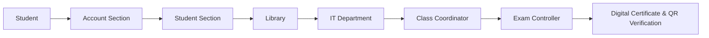

# CT UNIVERSITY - SECURE DIGITAL NO-DUES & EXAMINATION ELIGIBILITY CLEARANCE SYSTEM

An enterprise full-stack web application designed for universities to replace paper-based clearance forms with a sequential, role-based, cryptographically verified digital clearance system.



---

## 🌟 Key Features

1. **Sequential Clearance Pipeline:**
   $$\text{Student} \rightarrow \text{Account Section} \rightarrow \text{Student Section} \rightarrow \text{Library} \rightarrow \text{IT Dept} \rightarrow \text{Class Coordinator} \rightarrow \text{Exam Controller} \rightarrow \text{Digital Certificate}$$
2. **Authoritative Fee Verification:**
   - Account Section verifies official payment records.
   - Prevents approval if outstanding fee balance is greater than zero.
3. **Role-Based Access Control (8 Distinct Roles):**
   - Student, Account Section, Student Section, Library, IT Department, Class Coordinator, Examination Controller (Head), Admin.
4. **Cryptographic Certificate Engine:**
   - Non-guessable 192-bit verification tokens.
   - High-density QR code for instant mobile verification.
   - Asymmetric RSA-2048 cryptographic digital signature.
   - Tamper-evident PDF certificate generation with watermark and institutional crest.
5. **Public Real-Time Verification Portal (`/verify/:token`):**
   - Anyone can scan the QR code to verify validity (VALID, REVOKED, or NOT FOUND).
   - Strict privacy shield: Displays credential status without exposing private financial records.
6. **Multi-Factor Authentication (MFA):**
   - RFC 6238 TOTP authentication for privileged accounts (Admin, Account, Coordinator, Exam Controller).
7. **Comprehensive Audit & Threat Surveillance:**
   - Immutable audit logs tracking every approval, remark, IP address, and JSON diff.
   - Real-time security event monitor detecting brute-force attempts and workflow tampering.

---

## 🛠️ Technology Stack

- **Frontend:** React 18, Vite, TypeScript, Tailwind CSS, Lucide React, React Router 6.
- **Backend:** Node.js, Express, TypeScript, Helmet, CORS, Express-Rate-Limit, Cookie-Parser, Zod.
- **Database & ORM:** Prisma ORM, SQLite (local development / zero setup) & PostgreSQL (production schema provided in `schema.postgresql.prisma`).
- **Cryptography & Documents:** Node.js Crypto (RSA-2048, SHA-256), PDFKit, QRCode, OTPAuth / Otplib.

---

## 🚀 Quick Start Guide

### 1. Prerequisites
- Node.js (v18+ or v20+ or v22+)
- npm or pnpm

### 2. Backend Setup
```bash
cd backend
npm install
npx prisma generate
npx prisma db push
npx tsx src/prisma/seed.ts
npm run dev
```
Backend will start on `http://localhost:5000`.

### 3. Frontend Setup
```bash
cd frontend
npm install
npm run dev
```
Frontend will start on `http://localhost:5173`.

---

## 🔑 Test Accounts & Evaluation Guide

A top **Evaluation Quick-Role Switcher** bar is embedded at the top of the interface for 1-click test login as any of the 8 roles:

| Role | Name | Email | Password | Test Scenario |
| :--- | :--- | :--- | :--- | :--- |
| **Student 1** | Rahul Sharma | `rahul.sharma@ctuniversity.edu` | `Password123!` | Clean fee ($0.00 bal). Ready to submit clearance and test sequential approvals. |
| **Student 2** | Priya Patel | `priya.patel@ctuniversity.edu` | `Password123!` | Has $1,500 pending fee. Demonstrates fee clearance block. |
| **Student 3** | Amit Verma | `amit.verma@ctuniversity.edu` | `Password123!` | Pre-cleared. Download PDF certificate and test live QR verification. |
| **Account Section** | Vikram Mehta | `account@ctuniversity.edu` | `Password123!` | Verifies student tuition & examination fees. Authoritative fee source. |
| **Student Section** | Anita Roy | `studentsection@ctuniversity.edu` | `Password123!` | Verifies student conduct and administrative records. |
| **Library Head** | Dr. S. Nair | `library@ctuniversity.edu` | `Password123!` | Verifies book returns and outstanding library fines. |
| **IT Dept** | Rajesh Kumar | `itdept@ctuniversity.edu` | `Password123!` | Verifies campus computing assets and lab accounts. |
| **Class Coordinator**| Prof. Arun Gupta | `coordinator@ctuniversity.edu` | `Password123!` | Reviews all 4 department approvals and academic attendance. |
| **Exam Controller** | Dr. K. Sharma | `examcontroller@ctuniversity.edu` | `Password123!` | Final authority: re-verifies fees, grants Exam Eligibility, issues signed Certificate. |
| **Administrator** | Admin User | `admin@ctuniversity.edu` | `Password123!` | System metrics, security threat events, audit logs, certificate revocation. |

---

## 🧪 Automated End-to-End Workflow & Security Tests

Run the comprehensive 30-case automated test suite:
```bash
cd backend
npx tsx src/tests/e2e_workflow.test.ts
```

### Verified Test Cases:
- [x] Test 1-5: Student submission, Request ID formatting (`ND-YYYY-XXXXX`), and initial PENDING state.
- [x] Test 6-15: Complete sequential approval advancement: Account $\rightarrow$ Student Section $\rightarrow$ Library $\rightarrow$ IT $\rightarrow$ Coordinator $\rightarrow$ Exam Controller.
- [x] Test 16-19: Final Exam Controller authorization, `EXAM_ELIGIBLE` status, and Certificate creation.
- [x] Test 20-21: Cryptographic RSA-2048 signature verification and tampered payload rejection.
- [x] Test 22-23: Outstanding fee block (Account Section cannot approve student with unpaid balance).
- [x] Test 24-25: Sequence violation defense (Library cannot approve before Account Section).
- [x] Test 26-27: Role authorization barrier (Class Coordinator cannot approve Account Section).
- [x] Test 28-29: Duplicate active submission prevention.
- [x] Test 30: Certificate revocation and public invalidation display.

---

## 🔒 Security Documentation

Read [SECURITY.md](file:///C:/Users/brije/.gemini/antigravity/scratch/secure-nodues-system/SECURITY.md) for full details on threat modeling, cryptographic key storage, defense-in-depth architecture, and production deployment recommendations.
